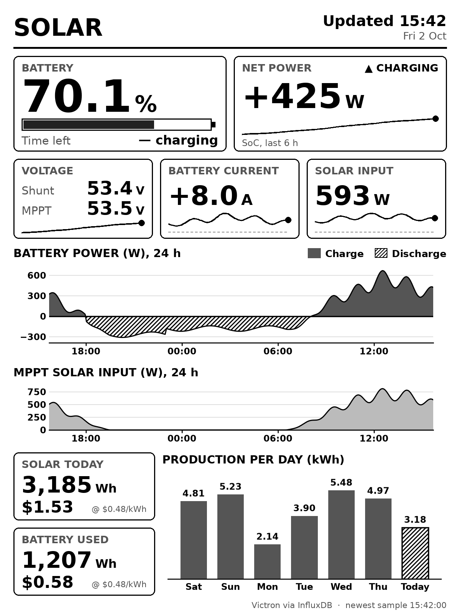
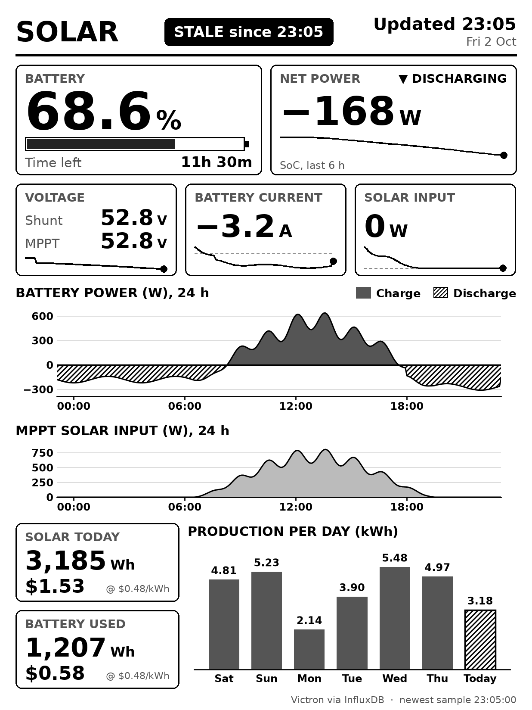
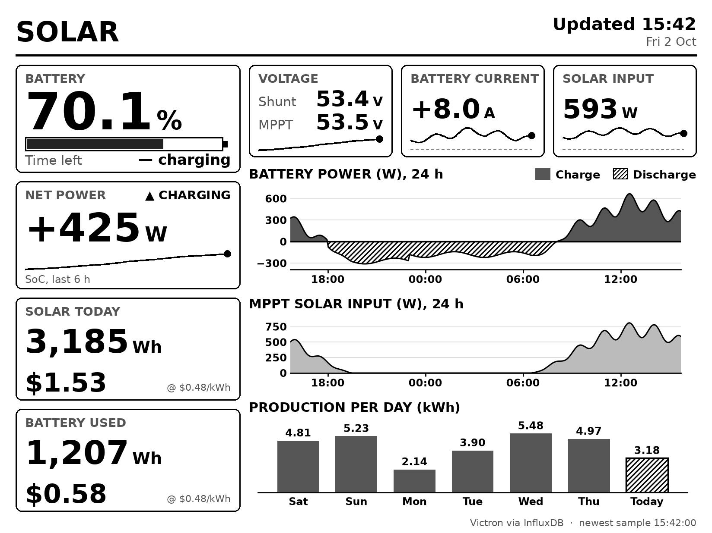
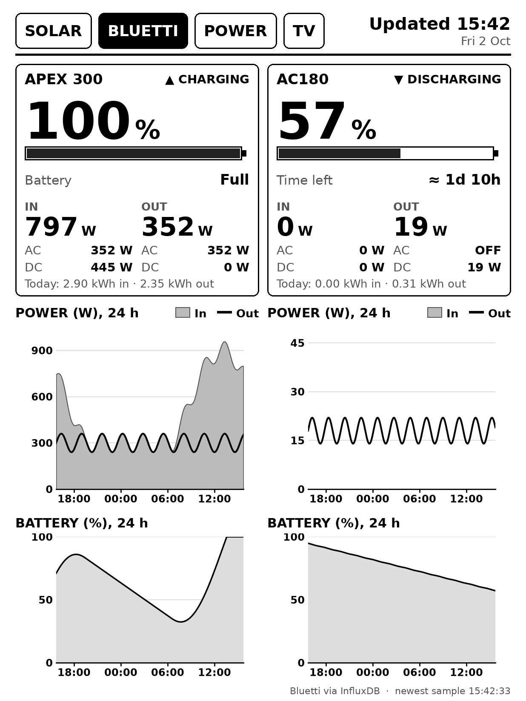
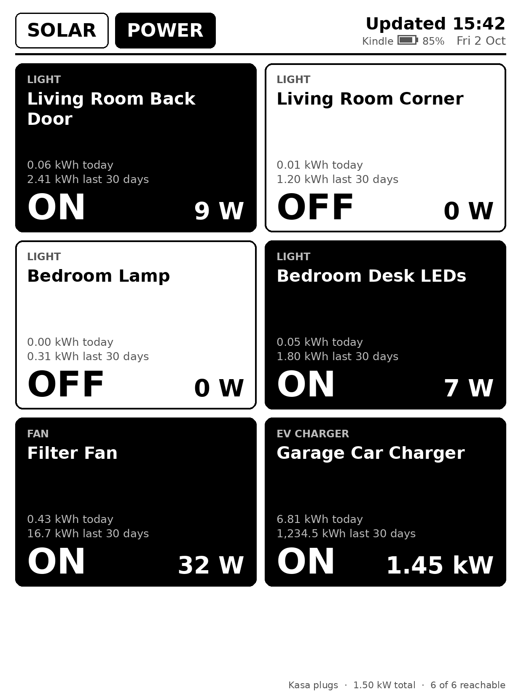
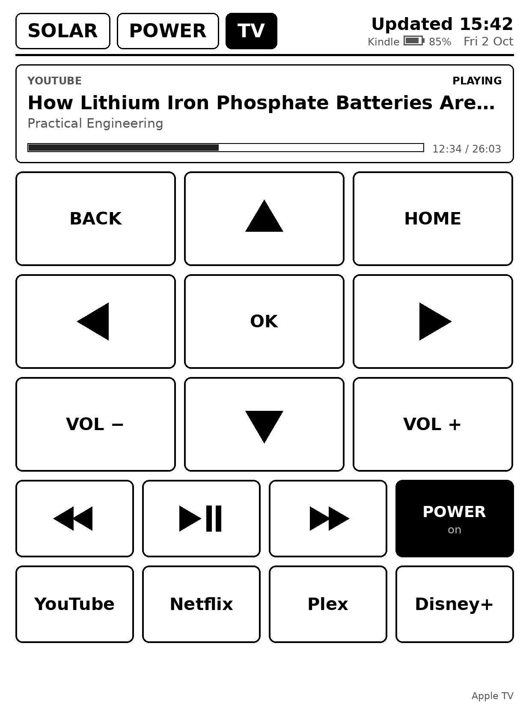

# kindle-solar-dashboard

Renders Victron solar/battery stats from InfluxDB as a 1236×1648 8-bit grayscale PNG
for a wall-mounted, jailbroken Kindle Paperwhite 11th gen. The data and queries
mirror the **Solar Setup Home** Grafana dashboard.

| Portrait: daytime (charging) | Portrait: night (discharging, InfluxDB down) |
|---|---|
|  |  |

Landscape (`/landscape.png`):



Bluetti tab (`/portrait.png?page=bluetti`):



Power tab (`/portrait.png?page=lights`):



TV tab (`/portrait.png?page=tv`):



*(Screenshots use synthetic data: `python -m kindle_dash.sample docs/sample.png America/Los_Angeles [solar|bluetti]`.)*

## What's on it

| Tile / chart | Source (Grafana panel) |
|---|---|
| Battery SoC %, gauge, time left | `state_of_charge_percent`, `time_to_go_s` (smartshunt) |
| Net power + charging/discharging state, SoC sparkline (6 h) | `battery_power_w`, `battery_current_a` (smartshunt) |
| Voltage: shunt and MPPT | `battery_voltage_v` (smartshunt, smartsolar_mppt) |
| Battery current, solar input W (+ 6 h sparklines) | `battery_current_a`, `pv_power_w` |
| Battery power, 24 h: solid fill = charge, hatched = discharge | "Net Battery Power" |
| MPPT solar input, 24 h | `pv_power_w` timeseries |
| Solar today Wh / $, battery used today Wh / $ | "Solar Production" / "Battery Usage" integrals, from local midnight |
| Production per day (7 days, today hatched since it's partial) | "Production Per Day" |

### Bluetti page

The **BLUETTI** tab shows the Bluetti power stations that
bluetti2influx (the separate service in `~/docker/bluetti2influx`) reads over Bluetooth into the `bluetti` bucket
(`BLUETTI_BUCKET`), one column per station:

- battery %, charging / discharging / idle, and a rough time to empty or to full from
  the capacity in `BLUETTI_STATIONS` and the power now (it ignores inverter losses)
- power in and out, each split into AC and DC; an output that's switched off reads **OFF**
- energy in and out since midnight
- power in (filled) and out (line), and battery %, over 24 h

`BLUETTI_STATIONS` lists the models to show, in order, with their capacity in Wh
(default `AP300=2764.8,AC180=1152`; add the expansion batteries' capacity if you have
any). A model in the data that isn't listed is shown after them, without a time estimate.
A station with no reading for 2 minutes (bluetti2influx stopped, e.g. to use the
Bluetti app) shows **NO DATA SINCE HH:MM**. AP300 counts as "in" what it passes
through from the grid as well as what charges the battery, so the time to full uses in − out.

### Camera page

The **CAMERA** tab shows a still from each UniFi Protect camera in `PROTECT_CAMERAS`
(`name=Label`, by the camera's name in Protect), converted to the panel's 16 grays with
dithering. Tap a picture to take a new one. While the Kindle shows the page, the stills
refresh every `CAMERA_REFRESH_SECONDS` (30); otherwise every 5 minutes, so the health page
knows the camera works. Stills stay in memory only.

The dashboard logs in to UniFi OS at `PROTECT_HOST` with `PROTECT_USER` / `PROTECT_PASSWORD`;
create a local Protect user with the **View Only** role for it. Full-resolution stills come
from Protect's integration API (Protect 5+); older versions give 640×360 ones. Protect's
self-signed certificate isn't verified, so keep this on the LAN. HomeKit-only cameras
(e.g. Logitech Circle View) can't be shown: Apple Home doesn't share their stills.

If the picture shows as a photo negative on the Kindle (only the picture; text and charts
look normal), turn off **Dark Mode** in the Kindle's settings. Its display hardware keeps
inverting photo-like areas even while the dashboard runs instead of the Kindle UI.

### Health

Every page's header turns the date into a black **⚠ N ISSUES** badge while something
isn't working. Tap the clock (on any page) for the health page: a row per subsystem with
**OK** or **PROBLEM** and what it last did:

| Check | Problem when |
|---|---|
| Solar (Victron) | InfluxDB fails, or no new Victron reading for 10 min |
| Bluetti, per station | InfluxDB fails, or no reading for 2 min (bluetti2influx stopped or out of range) |
| Kasa plugs | any plug unreachable |
| Apple TV | not paired, or can't connect |
| Camera, per camera | the last snapshot failed |

Checks run every 15 s. `/admin` lists the same checks, and `/status` has them as JSON.

### Power page

The **POWER** tab (`page=lights` in URLs) shows a big tile per Kasa smart plug (`KASA_HOSTS`): solid
black is ON, outlined is OFF, pale gray is unreachable. Tap a tile to toggle it.
Each tile shows what the plug powers (from `KASA_HOSTS`), its name on up to two lines,
and, for plugs with energy monitoring like the EP25, the power now and kWh today and
over the last 30 days. Like the Kasa app's "past 30 days", that's the 30 full days before
today, summed from the plug's daily totals, which are re-read every 10 minutes. The footer shows the total power.

Plugs whose kind is in `CONFIRM_KINDS` (default: `ev charger`) need two taps on the
Kindle: the first turns the tile into **TAP AGAIN TO TURN OFF/ON** for 10 seconds, and
the second switches it. Tapping anything else cancels. The admin page switches them in one press.
The Pi talks to the plugs directly on the LAN (python-kasa), so nothing changes in
Apple Home, and a change made either place shows up in the other. The page
re-reads the plugs every `LIGHTS_REFRESH_SECONDS`. The Kindle picks up changes made elsewhere at its next poll.

The plugs are addressed by IP because broadcast discovery doesn't reach them from
the Pi, so give them DHCP reservations.

### TV page

The **TV** tab is a remote for the Apple TV at `ATV_HOST`, using pyatv over the LAN:

- a now-playing panel: app, title, artist or show, play state, and a progress bar
- a 3×3 pad: **BACK** ▲ **HOME** / ◀ **OK** ▶ / **VOL −** ▼ **VOL +**
- skip back, play/pause, skip forward, and **POWER** (solid while the TV is on)
- up to four app shortcuts from `ATV_APPS` (`Name=bundle.id,...`)

Remote keys only flash the button; the Kindle puts its image back without fetching
a new one. Play/pause, skips, power and app launches wait 1.5 s for the Apple TV to
report the change, then redraw the page. The Apple TV pushes now-playing changes,
and the Kindle shows them at its next poll.

**Pairing:** open `/admin` and, under Apple TV, press **Pair** for *Remote control*.
The TV shows a PIN; type it in. Then do the same for *Now playing* (AirPlay). The
credentials are saved in the container's `data` volume (`/data/appletv.json`, mode
600), so they survive rebuilds. Once paired, `/admin` lists the installed apps with
their bundle IDs, ready to copy into `ATV_APPS`.

Design rules for e-ink: every gray is a multiple of `0x11` (the panel's 16 levels),
nothing relies on colour, type is large and bold, and the clock shows when the page was drawn.
When InfluxDB can't be reached, the last good image is kept and gets a black
**STALE since HH:MM** badge.

## Running it (Raspberry Pi, Docker)

The service has its own compose project in this folder. It joins the existing
`docker_default` network so it can reach the `influxdb` container by name, and
it doesn't touch `../docker-compose.yml`.

```sh
cd ~/docker/kindleDash
cp .env.example .env        # then set INFLUX_TOKEN (read access to the victron bucket is enough)
docker compose up -d --build
curl -s localhost:8765/health
```

Set `CONTROL_TOKEN` and `ADMIN_PASSWORD` in `.env` (see [Security](#security)), then open
`http://<pi>:8765/admin` in a browser and log in as `admin`.

### Security

Every route needs a credential except `/health`, which Docker's healthcheck uses and which only reports whether rendering is current:

- **The Kindle's routes** (`/portrait.png`, `/landscape.png`, `/dashboard.png`, `/tap`, `/rotate/count`)
  need `CONTROL_TOKEN` in an `X-Kindle-Token` header (`TOKEN` in the Kindle's `config.sh`).
  With `CONTROL_ALLOW_IPS` set, they also have to come from one of those addresses. Give the Kindle a DHCP reservation.
- **`/admin` and `/status`** use HTTP Basic auth, as `admin` / `ADMIN_PASSWORD`, so a phone or laptop
  browser can log in. Admin buttons refuse posts started from another site.
- Either credential left empty switches its routes off (503) rather than leaving them open.

It's plain HTTP on the LAN, so anyone who can watch your Wi-Fi traffic could read the
token or password. Don't forward the port.

### Admin page

`/admin` shows what the Kindle is showing (page, orientation, last fetch, battery) with a
preview of that image, links to preview any page in either layout, the solar data
status, a **Rotate Kindle 90°** button, a button per plug, and Apple TV pairing.

### Environment variables

| Variable | Default | Notes |
|---|---|---|
| `INFLUX_URL` | `http://influxdb:8086` | container name on `docker_default` |
| `INFLUX_TOKEN` | – | **required**; keep it in `.env` (git-ignored) |
| `INFLUX_ORG` | `sp_inc` | |
| `INFLUX_BUCKET` | `victron` | |
| `TZ` | `America/Los_Angeles` | used for "today", day buckets and timestamps |
| `PRICE_PER_KWH` | `0.48` | $ per kWh for the cost figures |
| `REFRESH_SECONDS` | `30` | query + render interval |
| `CHART_HOURS` / `SPARK_HOURS` / `DAYS` | `24` / `6` / `7` | chart, sparkline and bar-chart spans |
| `CONTROL_TOKEN` | – | **required**: shared secret for the Kindle's routes; it sends it as `X-Kindle-Token`. Generate with `openssl rand -hex 16`. |
| `CONTROL_ALLOW_IPS` | – | optional comma-separated list; the Kindle's routes refuse other addresses (403) |
| `ADMIN_PASSWORD` | – | **required** for `/admin` and `/status` (user `admin`) |
| `KASA_HOSTS` | – | comma-separated plug IPs for the lights page, in display order, each optionally `=kind` for the label on its tile, e.g. `192.168.113.14=light,192.168.113.36=ev charger` |
| `LIGHTS_REFRESH_SECONDS` | `15` | how often plug states are re-read |
| `ATV_HOST` | – | Apple TV IP for the TV page (give it a DHCP reservation) |
| `ATV_APPS` | – | up to 4 app shortcuts, `Name=bundle.id,...`; `/admin` lists the installed ones |
| `ATV_CREDENTIALS` | `/data/appletv.json` | where pairing is saved (the `data` volume) |
| `CONFIRM_KINDS` | `ev charger` | comma-separated plug kinds that need a second tap on the Kindle; empty = none |
| `TOUCH_SWAP_XY` / `TOUCH_FLIP_X` / `TOUCH_FLIP_Y` / `TOUCH_MAX_X` / `TOUCH_MAX_Y` | off / off / off / `1235` / `1647` | maps raw touch coordinates to panel pixels; the defaults assume they already match (see [Taps](#taps)) |

### Endpoints

| Endpoint | |
|---|---|
| `GET /portrait.png[?rotate=0\|90\|180\|270]` | Latest 1236×1648 portrait render, served from memory. Sends an `ETag` and supports `If-None-Match` (returns 304). `/dashboard.png` is an alias. |
| `GET /landscape.png[?rotate=…]` | 1648×1236 landscape layout. The Kindle panel is physically portrait, so the client requests it with `rotate=90` or `270`. |
| `…&battery=<0-100>&charging=<0\|1>` | Optional on either image. The Kindle client sends its own battery this way, and the next render shows "Kindle [battery icon] 85%" in the header, next to the date. Low battery (under 20% and not charging) is drawn bold black. The indicator disappears if no report has arrived for 15 minutes. Malformed values are ignored. |
| `…&page=solar\|bluetti\|lights\|tv\|cameras\|health` | Which page to show, on either image (default `solar`). |
| `POST /tap?x=&y=&rotate=&page=` | A tap at raw touch coordinates on the page the Kindle shows. Needs the token. Replies `204` if nothing was hit, otherwise lines: `flash <left> <top> <width> <height>` (panel pixels), `page <name>`, `redraw`. |
| `GET /rotate/count` | Polled by the Kindle; it rotates once each time the counter goes up (the **Rotate** button on `/admin`). |
| `GET /admin` | Admin page for a browser (see [Admin page](#admin-page)). `/admin/image.png?page=&layout=` serves a page upright, and `POST /admin/rotate`, `POST /admin/plug?host=` and `POST /admin/tv/pair?protocol=companion\|airplay` / `/admin/tv/pin` / `/admin/tv/cancel` are its buttons. |
| `GET /status` | Admin login. Current values as JSON, plus `last_success`, `stale_since` and `last_error` |
| `GET /health` | 200 if the last successful render is under 3 minutes old, otherwise 503. The Docker `HEALTHCHECK` uses it. |

A background task queries InfluxDB and renders every `REFRESH_SECONDS`. Requests
never trigger a render. A cycle takes about 0.4 s on a Pi 5: three small Flux
queries, plus the per-day query every 5 minutes.

### Development

```sh
python3 -m venv .venv && .venv/bin/pip install -r requirements-dev.txt
.venv/bin/python -m pytest -q
```

## Kindle client

The client runs as **scriptlets**, the launcher used by the Universal Hotfix that
ships with current jailbreaks. KUAL is obsolete on this firmware. Any `.sh` file in
`documents/` appears in the library like a book and runs when you tap it.

```
kindle/
  kindledash/            -> Kindle drive: kindledash/      (/mnt/us/kindledash)
    config.sh               server, rotations, interval, ...
    kindledash.sh           the loop
  documents/             -> Kindle drive: documents/       (/mnt/us/documents)
    Solar Dashboard - Start.sh
    Solar Dashboard - Stop.sh
    Solar Dashboard - Log.sh
```

The loop:

1. sets `preventScreenSaver 1` and stops the Kindle UI (`stop lab126_gui`, falling back to `stop framework`) so the UI can't draw over the dashboard
2. every `INTERVAL` seconds, `curl`s the PNG with connect and total timeouts
3. if the image's md5 changed, draws it with FBInk using a partial refresh, with a full flashing refresh every `FULL_REFRESH_EVERY` (15) draws to clear ghosting
4. sends its own battery level and charging state (`lipc-get-prop com.lab126.powerd battLevel` / `isCharging`) with each fetch, for the header indicator
5. if a fetch fails, leaves the last image up, draws a small inverted "! offline since HH:MM" marker in the bottom-left corner, and toggles Wi-Fi via `lipc` to reconnect. The next successful fetch does a full redraw that removes the marker.

### Install (from a Mac)

`/mnt/us` on the Kindle is the root of its USB drive (`/Volumes/Kindle`).

```sh
git clone https://github.com/spoole50/kindleDash.git ~/kindleDash
cp -RX ~/kindleDash/kindle/kindledash /Volumes/Kindle/
cp -X ~/kindleDash/kindle/documents/*.sh /Volumes/Kindle/documents/
dot_clean /Volumes/Kindle
```

1. Check `SERVER` and `ROTATIONS` in `/Volumes/Kindle/kindledash/config.sh` (see [Rotating](#rotating)).
2. Eject. The three **Solar Dashboard** entries appear in the library.
3. Tap **Solar Dashboard - Log** first. It shows whether FBInk was found; the hotfix normally installs it at `/mnt/us/libkh/bin/fbink`.
4. Tap **Solar Dashboard - Start**.

The log is at `/mnt/us/kindledash/kindledash.log`.

### Power button

While the dashboard runs, the loop reads the power key directly (`/dev/input/event0`):

- **press**: toggles the backlight on or off, remembering the previous level
- **double-press** (two presses within 1.5 s): returns to the library. The two toggles cancel out, so the light ends where it started. It restarts the Kindle UI and opens Home, which can take up to about a minute.

On this Kindle (PW11, `bd71828-pwrkey`), the power-management chip only reports "pushed", with press and release at the same instant. How long the button is held can't be measured, which is why this uses press counting rather than a long press.
**Don't hold the button down:** a hold of 15 s or more forces a hardware restart.
Every press is logged and the log is saved to disk right away. Set `POWER_BUTTON=0` or change `DOUBLE_PRESS_MS` in `config.sh`.

### Rotating

`ROTATIONS` in `config.sh` lists the orientations to cycle through. The default is `"0 270"`:

| Value | Layout | Kindle held |
|---|---|---|
| `0` | portrait | upright |
| `90` | landscape | turned counter-clockwise (power button on the right) |
| `180` | portrait | upside down |
| `270` | landscape | turned clockwise (power button on the left) |

To switch to the next orientation, do either of these:

- **Touch and hold the screen for 2 s, then let go.** Taps and holds longer than 8 s are ignored. The hold is measured when you lift your finger.
- **Press Rotate at `http://<pi-ip>:8765/admin`**, for example from a phone. The Kindle picks this up at its next poll, within `INTERVAL`.

The Kindle shows "Rotating...", fetches the other layout and does a full refresh.
The current orientation is saved in `kindledash/rotation`, so it survives restarts. Delete that file to go back to the first entry in `ROTATIONS`.
To turn landscape the other way, swap `270` for `90` in `ROTATIONS`.

The first 20 touches of each run are logged with their raw coordinates, for example `touch 2100ms down x=... y=...`.
The touch panel's axes don't necessarily match the screen's. To accept the hold only in one area, such as a corner, touch that corner a few times, read the coordinates from the log, and set `TOUCH_AREA="xmin ymin xmax ymax"`.
`TOUCH_ROTATE=0` or `REMOTE_ROTATE=0` turns either trigger off.

### Taps

Set `TOKEN` in `config.sh` to the Pi's `CONTROL_TOKEN`. A touch shorter than
`TAP_MAX_MS` (1 s) is sent to the server with its raw coordinates. The server works
out what's under it, using the same geometry it drew with, and replies:

- **tab**: the tab flashes black and the Kindle fetches the other page (full refresh)
- **plug tile**: the tile flashes, the plug toggles, and the Kindle fetches the redrawn page (partial refresh). For a `CONFIRM_KINDS` plug, the first tap only asks for a second one.
- **nothing**: no reply body, nothing happens

The 2 s touch-and-hold still rotates. The current page is saved in
`kindledash/page`, next to `kindledash/rotation`.

After `IDLE_RETURN` seconds (300) without a tap, the Kindle goes back to
`HOME_PAGE` (`solar`). It checks once per `INTERVAL`, so the switch can come up to a
minute later. Set `IDLE_RETURN=0` to stay on the last chosen page.
It also turns the backlight off after `IDLE_RETURN` seconds without a tap or power
press, on any page, Solar included (`IDLE_BACKLIGHT_OFF=1`). The next tap only turns
the light back on and doesn't press anything. The power button toggles the light as
usual, and a light turned on with it stays on for another `IDLE_RETURN` seconds.

The server logs every tap as `tap raw=… panel=… image=… -> action` (`docker logs kindle-solar-dashboard`).
If taps land in the wrong place, the touch panel's axes don't match the screen.
Tap near the top-left and bottom-right corners in portrait, compare `raw` with where
you touched, and set `TOUCH_SWAP_XY`, `TOUCH_FLIP_X`/`TOUCH_FLIP_Y` and
`TOUCH_MAX_X`/`TOUCH_MAX_Y` in `.env` until `panel` matches.
A refused tap (wrong token, IP not allowed) is logged on the Kindle with its HTTP status.

### Stopping it

- **Double-press the power button** (see above).
- **Over SSH:** `sh "/mnt/us/documents/Solar Dashboard - Stop.sh"`.
- **Last resort:** hold the power button until the Kindle restarts. Nothing autostarts.

If the screen stays blank after returning to the library, press power twice (sleep, then wake) to force a repaint.
